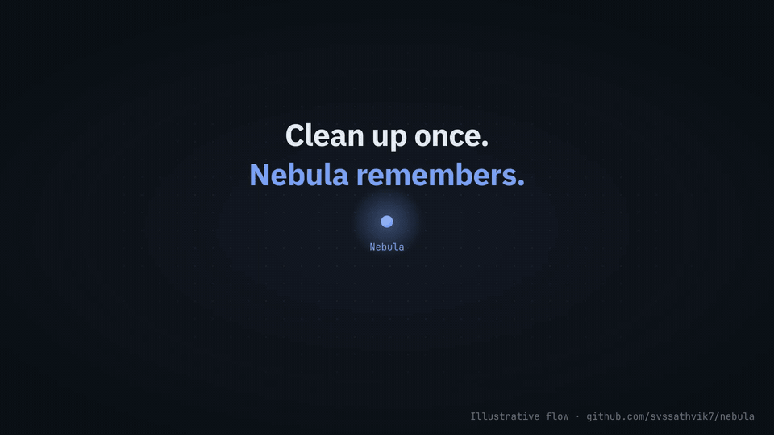

# Nebula

**A shared, self-learning memory layer for Claude Code and Codex.**



<sub>Illustrative flow, not a recording. [Watch as MP4](docs/media/nebula-cleanup-demo.mp4) ([1080p](docs/media/nebula-cleanup-explainer.mp4)) · [Read the full example](#example-a-cleanup-habit-you-never-wrote-down)</sub>

Teach a convention in Claude Code. Recall it in Codex when you return to the
same project. Lessons can travel in either direction, and across the related
projects you select, so switching agents does not mean teaching your preferences
all over again.

Nebula helps your coding agent learn from how you work: the decisions you make,
the corrections you give, and the workflows you repeat. It turns evidence from
your sessions and explicit feedback into persistent lessons, then makes those
lessons available across the related projects you select. Each lesson keeps its
context, rationale, and exceptions so the agent can assess when to suggest or
apply it.

For example: you clear `node_modules` in one stale project, a Rust `target/`
folder in another, and a `build/` folder in a third, each on a different day,
all in Claude Code. Weeks later, Codex hits a full disk and suggests the same
cleanup for your other inactive projects. Accept it once, and both agents
handle low disk space that way from then on. [See the full example](#example-a-cleanup-habit-you-never-wrote-down).

**Current status:** the local engine and synthetic learning demo are implemented.
End-to-end use in both hosts is still being validated. See the
[validation results](examples/results/README.md) for completed and pending stages.

[Shared memory across agents](#one-memory-across-claude-code-and-codex) ·
[Get started](#get-started) · [Everyday use](#everyday-use) ·
[How it works](#how-it-works) · [Documentation](#documentation) ·
[Contributing](contribution.md)

## What you can do

- **Carry learnings between Claude Code and Codex** so a lesson recorded in one
  host can guide the other in the same project or another selected project.
- **Build memory from your behavior and feedback** so lessons from earlier
  sessions can guide later work.
- **Share conventions and preferences** across a selected group of projects.
- **Keep the reasons and exceptions** alongside a lesson, rather than saving
  an unconditional instruction.
- **Inspect and correct memory** through explicit acceptance, rejection,
  exceptions, correction, withdrawal, and disabling.
- **Pause learning and application** without deleting what you have taught.

The agent handles interpretation and reasoning in your existing session.
Nebula's Python/SQLite engine stores evidence, lessons, and feedback locally.
It uses only the Python standard library and makes no model calls of its own.
There is no separate model, embeddings service, or background daemon.

## One memory across Claude Code and Codex

### Example: a cleanup habit you never wrote down

Your disk keeps filling up. You never give your agent a cleanup policy; you
just tell it what to delete each time. (All the projects below are selected
children of the same Nebula.)

**March · Claude Code.** The agent reports the disk is 95% full. You say:
*“Clear `projectX/node_modules`.”* (12 GB. Last commit: four months ago.)

**April · Claude Code.** Low on space again. You say: *“Delete the Rust
`target/` folder in `projectY`.”* (18 GB. Last commit: five months ago.)

**May · Claude Code.** Again. You say: *“Remove `projectZ/build`.”* (6 GB.
Last commit: three months ago.) Your active projects and your datasets were
never touched.

Three requests, three different tools, three different projects. Nebula links
them into one candidate lesson, with the pattern spelled out:

```text
Lesson    On low disk space, clear rebuildable build output
          (node_modules, target/, build/) in projects with no commits for 3+ months
Keep      Active projects, datasets, anything that can't be regenerated
Evidence  3 cleanups · Claude Code · projectX, projectY, projectZ
Status    candidate · not applied
```

**June · Codex.** You're working in another project when Codex hits a full
disk. Instead of asking you what to delete, or guessing, it suggests the pattern:

```text
Codex: Disk is 96% full. In 3 earlier cleanups (Claude Code) you cleared
       rebuildable build output in projects inactive for 3+ months.
       Matching now:
         projectQ/node_modules   9 GB   last commit 4 months ago
         projectR/target        14 GB   last commit 6 months ago
       Clear these, and do this automatically next time?
       Suggestion sg-7f3a. To accept, run in your terminal:

       python3 "$NEBULA_ENGINE" confirm --root "$NEBULA_ROOT" \
         --suggestion sg-7f3a --verdict accept
```

You run the command and type `NEBULA ACCEPT sg-7f3a`. Only a human at the
terminal can accept a suggestion; an agent cannot approve one for you.

**From then on · either agent.** When an agent runs into low disk space during
a session, it clears matching build output in inactive projects, then tells you
what it removed, how much space it freed, and which lesson it applied. Your
host's permission prompts still apply to the deletion. If it ever picks the
wrong thing, say *“never clean `projectQ`, I'm reviving it”* to add an exception,
or withdraw the lesson. A failed cleanup pauses the lesson until you review it.

Nebula doesn't watch your disk or delete anything itself. It runs no background
process; the agent in your current session does the cleanup with its normal
tools. The example shows the intended flow; end-to-end runs across both hosts
are still being validated (see [validation results](examples/results/README.md)).

### Why not just keep a LEARNINGS.md?

For a rule you can state up front, a Markdown file in the repo works well, and
you should use one. Nebula covers what a file doesn't:

- **Patterns you never wrote down.** Nobody writes the rule in the example above.
  Nebula works out the pattern (rebuildable output, inactive projects) from
  three separate requests that never stated it.
- **Nothing applies until you agree.** A one-off remark stays a candidate. A
  lesson applies automatically only after you accept it at the terminal, so an
  injected instruction in a file or web page cannot become a standing rule.
- **One memory, scoped to the projects you pick.** Claude Code and Codex share
  it across the selected repos, and it stays out of your team's git history.
- **It stays small and current.** Recall returns at most six relevant lessons,
  and lessons can be corrected, given exceptions, paused or withdrawn.

### How the agents share it

Both hosts read and write the same local memory at
`<nebula-parent>/.nebula/state.sqlite3`. Lessons are scoped to the projects you
select, rather than separated by the agent that learned them. Each agent uses
the shared skill to assess relevance, exceptions, and your current instructions.

The project must be registered in an enabled Nebula, with the skill and hooks
installed and active for each host you use. Opening the same folder alone does
not connect them. Nebula shares recorded lessons and evidence; it does not
transfer entire conversations. Live validation of the complete workflow across
both hosts remains in progress; see the [validation results](examples/results/README.md).

## Get started

You need **Python 3.11 or newer**, Git, and Claude Code or Codex for the agent
workflow. The engine and demo can run without either host. Local testing has
used macOS; [CI](.github/workflows/ci.yml) runs the engine tests and demo on
Ubuntu with Python 3.11–3.14. Host-specific validation is recorded separately.

### 1. Clone the repository

```sh
git clone https://github.com/svssathvik7/nebula.git
cd nebula
NEBULA_ENGINE="$PWD/scripts/nebula.py"
```

No Python packages need to be installed. Keep this checkout at the same location
after setup: installed skills and hooks point back to it.

To try the learning loop before connecting your projects:

```sh
python3 examples/demo.py
```

The demo uses temporary projects and synthetic acceptance receipts. It walks
through a lesson, acceptance, application in a sibling project, an exception,
and withdrawal. It does not change your Claude or Codex settings.

### 2. Choose the projects that share memory

A **Nebula** is a parent directory plus the child projects you explicitly select.
For example, suppose these projects already exist:

```text
projects/
├── api/          ← selected
├── worker/       ← selected
└── unrelated/    ← not selected
```

Replace the path below with your existing parent directory. All selected
projects must be inside it; repeat `--project` to select more children.
Run these commands in the same shell as step 1.

```sh
NEBULA_ROOT="/absolute/path/to/projects"

python3 "$NEBULA_ENGINE" init "$NEBULA_ROOT" \
  --project "$NEBULA_ROOT/api" \
  --project "$NEBULA_ROOT/worker"
```

This creates local state in `projects/.nebula/`, initially OFF. Initialization
refuses to overwrite an existing Nebula; for one already set up, use `status`
and `on` instead. To change which projects are selected later, see
[adding and removing projects](#add-or-remove-projects).

### 3. Connect your coding agents and turn it on

Preview the project settings and skill links Nebula will add:

```sh
python3 "$NEBULA_ENGINE" install --root "$NEBULA_ROOT" \
  --project "$NEBULA_ROOT/api" \
  --project "$NEBULA_ROOT/worker" \
  --host claude --host codex --dry-run
```

Use only `--host claude` or `--host codex` if you use one host. After reviewing
the preview, run the installation without `--dry-run`, then enable Nebula:

```sh
python3 "$NEBULA_ENGINE" install --root "$NEBULA_ROOT" \
  --project "$NEBULA_ROOT/api" \
  --project "$NEBULA_ROOT/worker" \
  --host claude --host codex

python3 "$NEBULA_ENGINE" on --root "$NEBULA_ROOT"
python3 "$NEBULA_ENGINE" status --root "$NEBULA_ROOT"
```

To start with passive learning, use `on observe` instead of `on`. Bare `on`
selects full operation; see the mode commands under [everyday use](#everyday-use).

Installation adds registrations to the selected child projects and preserves
unrelated settings. It does not change user-wide configuration.

Start a **fresh Claude Code or Codex session inside a selected project**, review
project and hook trust through the host's native flow, and invoke the Nebula
skill (`/nebula` in Claude Code). Follow the
[host integration guide](skills/nebula/references/integration.md) if skills or
hooks are not discovered. Run `/nebula doctor` first: it
[checks the setup](#check-your-setup) and names a fix for each problem.

You can also ask your agent to do the setup. Before the skill is installed,
give it the absolute path to this checkout's `skills/nebula/SKILL.md` and name
the parent directory and child projects you want to include.

## Everyday use

### Learn quietly before enabling learned behavior

Invoke `/nebula on observe` in an installed parent or selected child to record
observations and candidate lessons while you continue ordinary work. Nebula
does not propose suggestions, ask for confirmation or apply learned behavior
in this mode, including mature lessons. Its engine refuses suggestions and
new application claims. Use `/nebula status` and `/nebula inspect` to review
what it has learned; the agent maps these to the utility's `status` and
`inspect --lesson ID` commands. Switch to `/nebula on` when ready for full mode.
This preserves memory and does not automatically qualify candidate lessons.

| Skill request | Utility command | Behavior |
| --- | --- | --- |
| `/nebula on` | `on --root PARENT` | Select full mode; recall, suggest and apply qualifying lessons |
| `/nebula on full` | `on full --root PARENT` | Explicitly select full mode |
| `/nebula on observe` | `on observe --root PARENT` | Capture evidence and record candidates quietly |
| `/nebula off` | `off --root PARENT` | Stop capture and learned application; retain memory |

Bare `on` always selects full, including after observation mode. Unsupported
mode values are rejected without changing configuration. The low-level
`mode off|observe|full` command remains an alias. For automatic mode checks,
the skill uses `status --summary`, which returns only current `mode` and
`enabled` regardless of lesson count. Detailed `status` remains available
when you ask to inspect the lesson catalog, health and recent evidence.

Observation writes only Nebula's learning state through its existing session
workflow; it adds no daemon, polling or model calls. Hooks store metadata and
digests, not full transcripts. Unknown-origin prompts can support candidates
but cannot count toward observational maturity without explicit attribution.
This mode limits Nebula's learned behavior; your agent still performs the
ordinary work you request. It cannot cancel a host action already running.
Update both runtime and skill before using it; older runtimes understand only
`enabled` and do not enforce observation mode. The CLI's existing
`observe --host HOST` command remains event ingestion, not mode selection.

In full mode, work normally in a selected project with the Nebula skill active. Teach
preferences explicitly and include the reason or an exception when it matters:

> When I ask you to free up space, start with build caches and files we can
> regenerate. Keep my datasets because I work offline, unless I explicitly
> tell you a particular dataset can go.

The agent can record a candidate lesson and suggest it when relevant. Once the
lesson qualifies, it can apply the preference in matching situations across
selected projects, subject to your current instructions and host permissions.
Source files alone do not teach Nebula your intent.

**Acceptance currently requires a terminal step.** Host prompt hooks cannot
reliably distinguish human submissions from generated turns, so saying “yes”
in chat alone does not confirm a lesson. When the agent presents a suggestion,
run the command it displays yourself, for example:

```sh
python3 "$NEBULA_ENGINE" confirm --root "$NEBULA_ROOT" \
  --suggestion SUGGESTION_ID --verdict accept
```

Replace `SUGGESTION_ID` with that suggestion's ID and type the requested
`NEBULA ACCEPT <suggestion-id>` acknowledgement in the interactive terminal.
The agent must not type or simulate it for you.

You can reject a suggestion, state an exception with a reason, correct or
withdraw a lesson, or disable its automatic application. A rejection or
exception blocks the current decision even if the lesson remains confident.
See the [shared skill](skills/nebula/SKILL.md#acceptance-and-correction) for the
feedback workflow.

Useful commands, using the variables from setup:

| Action | Command |
| --- | --- |
| Check activation, lessons, and recent events | `python3 "$NEBULA_ENGINE" status --root "$NEBULA_ROOT"` |
| Inspect a lesson and its evidence | `python3 "$NEBULA_ENGINE" inspect --root "$NEBULA_ROOT" --lesson LESSON_ID` |
| Pause capture and automatic application; keep memory | `python3 "$NEBULA_ENGINE" off --root "$NEBULA_ROOT"` |
| Resume full operation | `python3 "$NEBULA_ENGINE" on --root "$NEBULA_ROOT"` |
| Learn quietly without learned application | `python3 "$NEBULA_ENGINE" on observe --root "$NEBULA_ROOT"` |
| Check current mode with bounded output | `python3 "$NEBULA_ENGINE" status --summary --root "$NEBULA_ROOT"` |
| Run retention and storage maintenance | `python3 "$NEBULA_ENGINE" maintain --root "$NEBULA_ROOT"` |
| Generate an HTML analytics report | `python3 "$NEBULA_ENGINE" stats --root "$NEBULA_ROOT" --open` |
| Check setup and get a fix for each problem | `python3 "$NEBULA_ENGINE" doctor --root "$NEBULA_ROOT"` |
| See available commands | `python3 "$NEBULA_ENGINE" --help` |

To remove a host's registration from a selected project:

```sh
python3 "$NEBULA_ENGINE" uninstall --root "$NEBULA_ROOT" \
  --project "$NEBULA_ROOT/api" --host claude
```

Repeat for other projects and hosts as needed. Uninstall removes unchanged
Nebula-owned registrations, leaves modified entries in place and reports them,
and keeps learned state.

### Add or remove projects

Your project list can change without starting over. Ask your agent:

| Skill request | What happens |
| --- | --- |
| `/nebula add billing` | Selects `billing`, then installs Nebula there. Lessons, evidence and mode are kept. |
| `/nebula remove old-app` | Uninstalls Nebula from `old-app`, then deselects it. Lessons are kept. |

The equivalent utility commands are:

```sh
python3 "$NEBULA_ENGINE" add-project --root "$NEBULA_ROOT" --project "$NEBULA_ROOT/billing"
python3 "$NEBULA_ENGINE" remove-project --root "$NEBULA_ROOT" --project "$NEBULA_ROOT/old-app"
```

After `add-project`, run `install` for the new project as in
[setup step 3](#3-connect-your-coding-agents-and-turn-it-on). `remove-project`
refuses while the project still has Nebula registrations, so run `uninstall`
first. It also refuses to remove the last project; use `off` to pause instead.
Removing a project whose folder is already deleted works. Lessons that were
scoped only to removed projects are listed in the output so you can decide
whether to withdraw them.

### Check your setup

If Nebula seems inactive, ask your agent for `/nebula doctor`. It checks the
setup without changing anything and gives a fix for each problem:

```text
✗ claude in api   Skill link points to ~/old/nebula/skills/nebula, which no longer has SKILL.md;
                  hook script ~/old/nebula/scripts/nebula_hook.py no longer exists.
                  Fix: /nebula uninstall api --host claude, then /nebula install api --host claude.
! project worker  Nebula is not installed here for any host.
                  Fix: /nebula install worker
! mode            Nebula is off: nothing is captured or applied.
                  Fix: /nebula on
```

| Check | What it looks for |
| --- | --- |
| config | `.nebula/config.json` exists and is valid |
| state | The database opens, passes an integrity check, is writable and has storage room |
| mode | Nebula is not off |
| project | Each selected project folder still exists and has Nebula installed for at least one host |
| host in project | The skill link resolves, every Nebula hook is still registered, and the Python interpreter and hook script it calls still exist. Installs from another checkout are flagged. |
| interrupted install | No install was left half-finished |

The utility command is `python3 "$NEBULA_ENGINE" doctor --root "$NEBULA_ROOT"`.
It prints JSON listing only the problems, failures first and at most 20, with
passing checks counted in `summary`; add `--all` to list every check. It exits 1
when any check fails. Doctor cannot see host trust
decisions. If every check passes but hooks still don't fire, review project and
hook trust in the host, as described in the
[host integration guide](skills/nebula/references/integration.md).

### Multi-Nebula stats

From a folder containing several independent Nebulas, ask your agent for
“nebula stats”, or run:

```sh
python3 "$NEBULA_ENGINE" stats --root /path/to/projects --open
# Choose a new output filename; existing files are never overwritten.
python3 "$NEBULA_ENGINE" stats --root /path/to/projects --output /path/to/report.html
```

The requested ancestor need not be a Nebula. With no `--root`, the command scans
the current folder. It generates a standalone, interactive HTML report; `--open`
opens the saved file in your browser. It works while Nebula is OFF and needs no
initialization or host configuration. Browser-opening failures leave the report
available at the returned path. The command prints only compact coverage and
warnings, keeping lesson data out of agent context.

The dashboard shows learned triggers, actions, contexts, exceptions and rationale;
current maturity/confidence; selected projects; lesson versions; feedback counts;
successful, failed, unknown and unfinished applications; retained recent activity;
and storage/coverage. Filter details by Nebula, actual project, lesson kind,
maturity and text. Global summary cards remain global. Confidence measures
preference consistency. The default lesson view shows current versions; switch
Versions to inspect older versions or all versions together.
A suitable recorded application counts as successful;
time saved requires a manual-work baseline and is deferred.

Schema 3 stores compact counters in the same transactions as suggestions,
feedback and applications. Suggestion replays, repeat verdicts and completion
replays do not inflate counts. Acceptance is distinct from execution. Counters
survive raw history expiry and start at analytics initialization, with no
historical backfill. Normal engine use upgrades valid older state; stats reads
schemas 1/2/3 without migration. Older roots show analytics uninitialized and
partial retained history. Unavailable roots show diagnostics rather than zero
activity. Each root is read consistently, at its own snapshot time.

Discovery skips `.git`, `.nebula`, `.nebula-reports`, `.superpowers`, `.venv`,
`venv`, `node_modules`, `target`, `dist`, `build` and `__pycache__`, and does not
follow descendant directory symlinks. It stops at 10,000 directories, 100,000
entries, depth 12 or 100 candidate roots. Details are capped at 1,000 lesson
versions and 100 activity records per root; the payload is capped at 8 MiB.
Limits and read failures produce visible coverage warnings. Aggregate counts
use the full available state even when details are truncated.

Reports use no remote assets and need no server or frontend dependencies. They
contain local paths, lesson text and retained human reasons. New files are
owner-only; output collisions, symlink paths and `.nebula` destinations are
refused. Inspect reports before sharing and regenerate them to refresh data.
Automatically named reports are ignored by Git; custom output names require
your own ignore rules.

For a synthetic preview and reproducible local measurements:

```sh
python3 examples/analytics_demo.py --output /path/to/new-report.html
python3 scripts/benchmark_analytics.py --runs 100
```

For browser regression checks, evaluate the function in
`examples/analytics_browser_checks.js` in the console of a fresh synthetic
report. It checks the current-version default, version history and project
activity, then restores the filters.

The benchmark compares the same schema/workflow with analytics instrumentation
enabled and disabled. It measures local bookkeeping and report generation, not
user time saved or a historical release. See [analytics semantics](skills/nebula/references/analytics.md).

## How it works

The learning loop is **capture → candidate lesson → suggestion → qualification
→ recall and application → feedback**. The shared skill guides the agent;
the engine stores records and checks whether a lesson is eligible to apply.
It never executes stored action text itself.

Lessons begin immature. They qualify through repeated, attributable human
choices and verified outcomes across sessions and projects, or through your
explicit acceptance of an identified suggestion. Automatic application also
requires confidence above 0.75, matching context and scope, and ordinary host
permission. A failed application suspends that lesson version until review.
Confidence measures preference consistency, not the probability that a choice
is correct.

Memory is bounded: raw evidence expires after 14 days, observational samples
after 90 days, and recall returns at most six summaries within 8 KiB. Compact
confirmations and decision blocks survive raw evidence expiry. Maintenance runs
during session interaction. Missing, corrupt, or full state withholds learned
application while ordinary host work continues.

Capture stores event metadata and digests rather than full prompts, command
arguments, or tool output. Lessons and feedback still contain project context
and human reasons, so inspect local state before sharing it. Nebula does not
import old transcripts or train a model on your history.

## Documentation

| Guide | What it covers |
| --- | --- |
| [Shared agent skill](skills/nebula/SKILL.md) | Setup, recall, teaching, feedback, and application workflow |
| [Host integration](skills/nebula/references/integration.md) | Claude/Codex registration, trust, capture, and input boundaries |
| [Record formats](skills/nebula/references/records.md) | Record schemas, evidence, feedback, and application commands |
| [Analytics semantics](skills/nebula/references/analytics.md) | What `stats` counts, retention, coverage warnings, and report privacy |
| [Validation results](examples/results/README.md) | Verified stages, pending live tests, and local benchmark evidence |
| [Example scenarios](examples/agent-prompts.json) | Prompts for exercising the learning workflow |
| [Design](docs/superpowers/specs/2026-10-06-nebula-phase-1-design.md) | Architecture, qualification rules, scoring, and storage limits |

## Contributing

Bug reports, clearer examples, documentation improvements, tests, and host
integration fixes are welcome. Read the [contributor guide](contribution.md)
for development setup, validation commands, and pull request guidance.

## License

Nebula is released under the [MIT License](LICENSE).
